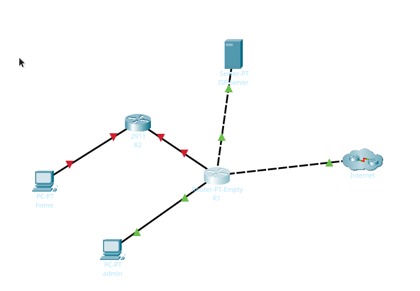
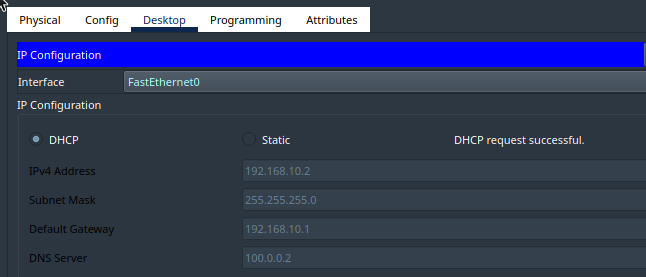

# Отчет по лабораторной работе 1.2
**Тема:** Настройка удаленного доступа, DHCP, NAT, ACL  
**Выполнили:** Капустин, Веселова, Поликарпова, гр. 439  

## Часть 1: Создание топологии и начальная конфигурация устройств

### Шаг 1

1. Перенесли в рабочую область устройства (`R1` — Router-PT-Empty, `R2` — 2911, ПК `admin` и `home`) и задали `Display Name` по топологии.
2. На `R1` выключили питание, во вкладке `Physical` установили платы `PT-ROUTER-NM-1CGE` в слоты `0, 1, 2, 3` (нумерация с правого края), в свободные слоты поставили заглушки и включили питание. Так появились интерфейсы `Gi0/0`, `Gi1/0`, `Gi2/0`, `Gi3/0`.
3. Соединили устройства по таблице подключений:

| От устройства | Порт | К устройству | Порт |
|---|---|---|---|
| R1 | Gi0/0 | Internet/Internet | Gi0/0 |
| R1 | Gi1/0 | ISP Server | Fa0 |
| R1 | Gi2/0 | admin | Fa0 |
| R1 | Gi3/0 | R2 | Gi0/0 |
| R2 | Gi0/1 | home | Fa0 |



### Шаг 2

Базовая конфигурация `R1` (пункты 2.1–2.8):

```text
enable
configure terminal
hostname R1
no ip domain-lookup
service password-encryption
enable secret cisco
username admin privilege 15 secret cisco
line console 0
logging synchronous
login local
speed 115200
exit
interface GigabitEthernet0/0
description UPLINK
ip address 100.0.0.6 255.255.255.252
no shutdown
exit
interface GigabitEthernet1/0
description SERVER
ip address 100.0.0.1 255.255.255.252
no shutdown
exit
interface GigabitEthernet2/0
description ADMIN
ip address 192.168.10.1 255.255.255.0
no shutdown
exit
interface GigabitEthernet3/0
description CLIENT
ip address 192.168.20.1 255.255.255.0
no shutdown
exit
ip route 0.0.0.0 0.0.0.0 100.0.0.5
end
copy running-config startup-config
```

## Часть 2: Настройка удаленного доступа по протоколу SSH

### Шаг 1: Настройка протокола SSH

```text
configure terminal
ip domain-name isp.net
crypto key generate rsa modulus 2048
ip ssh version 2
line vty 0 15
login local
logging synchronous
transport input ssh
end
copy running-config startup-config
```

> Если `line vty 0 15` выдаёт ошибку (у модели только 5 линий), используйте `line vty 0 4`.

### Шаг 2: Проверка подключения по SSH

1. На ПК `admin` задали `192.168.10.100`, маска `255.255.255.0`, шлюз `192.168.10.1`.
2. На `admin` в `Command Prompt` введено: `ssh -l admin 192.168.10.1` - вход через SSH успешно прошел, то же самое сделано с Telnet, но происходит автоматическая отмена со стороны удаленного хоста.

**Вопрос 1. Какой вариант подключения не сработал и почему?**

Сработал только SSH, Telnet не сработал: хост запрещает использование Telnet. На всех линиях `vty` задана команда `transport input ssh`, которая разрешает входящие сессии только по SSH. Попытка подключения по Telnet отклоняется маршрутизатором, а SSH проходит после ввода учётных данных `admin / cisco` из локальной базы (`login local`).

## Часть 3: Автоматическая настройка IP-адресов по протоколу DHCP

### Шаг 1: Настройка DHCP-ретрансляции

```text
configure terminal
interface GigabitEthernet3/0
ip helper-address 100.0.0.2
end
```

Клиентский DHCP Discover приходит на `Gi3/0` широковещанием, а `Server0` находится в другой сети. Ретранслятор перехватывает запрос и пересылает его серверу `100.0.0.2` как одноадресный.

### Шаг 2: Получение IP-адреса по DHCP на R2

```text
enable
configure terminal
hostname R2
no ip domain-lookup
interface GigabitEthernet0/0
description ISP
ip address dhcp
no shutdown
end
```

```text
R2# show ip interface GigabitEthernet0/0
GigabitEthernet0/0 is up, line protocol is up (connected)
  Internet address is 192.168.20.2/24
  Broadcast address is 255.255.255.255
  Address determined by DHCP
  MTU is 1500 bytes
  Helper address is not set
  Directed broadcast forwarding is disabled
  Outgoing access list is not set
  Inbound  access list is not set
  Proxy ARP is enabled
  Security level is default
  Split horizon is enabled
  ICMP redirects are always sent
  ICMP unreachables are always sent
  ICMP mask replies are never sent
  IP fast switching is disabled
  IP fast switching on the same interface is disabled
  IP Flow switching is disabled
  IP Fast switching turbo vector
  IP multicast fast switching is disabled
  IP multicast distributed fast switching is disabled
  Router Discovery is disabled
  IP output packet accounting is disabled
  IP access violation accounting is disabled
  TCP/IP header compression is disabled
  RTP/IP header compression is disabled
  Probe proxy name replies are disabled
  Policy routing is disabled
  Network address translation is disabled
  BGP Policy Mapping is disabled
  Input features: MCI Check
  WCCP Redirect outbound is disabled
  WCCP Redirect inbound is disabled
  WCCP Redirect exclude is disabled
```

**Вопрос 2. Какие IP-адрес `R2` и маску сети получил?**

`R2` получил адрес `192.168.20.2` с маской `255.255.255.0`. Адрес принадлежит сети `Gi3/0` маршрутизатора `R1`, поэтому DHCP-запрос дошёл до сервера через ретранслятор.

```text
R2# show ip route
R2# show ip route
Codes: L - local, C - connected, S - static, R - RIP, M - mobile, B - BGP
       D - EIGRP, EX - EIGRP external, O - OSPF, IA - OSPF inter area
       N1 - OSPF NSSA external type 1, N2 - OSPF NSSA external type 2
       E1 - OSPF external type 1, E2 - OSPF external type 2, E - EGP
       i - IS-IS, L1 - IS-IS level-1, L2 - IS-IS level-2, ia - IS-IS inter area
       * - candidate default, U - per-user static route, o - ODR
       P - periodic downloaded static route

Gateway of last resort is 192.168.20.1 to network 0.0.0.0

     192.168.10.0/24 is variably subnetted, 2 subnets, 2 masks
C       192.168.10.0/24 is directly connected, GigabitEthernet0/1
L       192.168.10.1/32 is directly connected, GigabitEthernet0/1
     192.168.20.0/24 is variably subnetted, 2 subnets, 2 masks
C       192.168.20.0/24 is directly connected, GigabitEthernet0/0
L       192.168.20.2/32 is directly connected, GigabitEthernet0/0
S*   0.0.0.0/0 [254/0] via 192.168.20.1
```

1. **Появился ли маршрут по умолчанию?** Да. Вместе с адресом `R2` автоматически получил от DHCP-сервера маршрут по умолчанию `S* 0.0.0.0/0` с административной дистанцией `254`.
2. **Через какой next-hop он ведёт?** Через `192.168.20.1` — это `Gi3/0` маршрутизатора `R1`, адрес из опции «шлюз по умолчанию» DHCP-сервера. Сверьте со своим выводом.

### Шаг 3: Маршрутизатор Cisco в качестве DHCP-сервера

```text
configure terminal
interface GigabitEthernet0/1
description LAN
ip address 192.168.10.1 255.255.255.0
no shutdown
exit
ip dhcp excluded-address 192.168.10.1
ip dhcp pool DHCP-POOL
network 192.168.10.0 255.255.255.0
default-router 192.168.10.1
dns-server 100.0.0.2
end
copy running-config startup-config
```

### Шаг 4: Проверка работы DHCP-сервера на R2

На `home` на интерфейсе `Fa0` включили `DHCP`.

**Вопрос 3. Какой IP-адрес получил ПК? Совпадают ли шлюз по умолчанию и DNS-сервер с указанными в DHCP-пуле?**

ПК получил адрес `192.168.10.2` (первый свободный адрес пула, так как `192.168.10.1` исключён). Шлюз `192.168.10.1` и DNS-сервер `100.0.0.2` совпадают с параметрами `default-router` и `dns-server` в `DHCP-POOL`.



**Вопрос 4. Вывод команд проверки DHCP-сервера.**

```text
R2#show ip dhcp binding
IP address       Client-ID/              Lease expiration        Type
                 Hardware address
192.168.10.2     0002.1745.0564           --                     Automatic
```

```text
R2#show ip dhcp pool
Pool DHCP-POOL :
 Utilization mark (high/low)    : 100 / 0
 Subnet size (first/next)       : 0 / 0 
 Total addresses                : 254
 Leased addresses               : 1
 Excluded addresses             : 1
 Pending event                  : none

 1 subnet is currently in the pool
 Current index        IP address range                    Leased/Excluded/Total
 192.168.10.1         192.168.10.1     - 192.168.10.254    1    / 1     / 254
```

## Часть 4: Трансляция сетевых адресов на «локальном» маршрутизаторе

### Шаг 1: Проверка связности

**Вопрос 5. Результат `ping 100.0.0.2` с `home` и его объяснение.**

```text
C:\> ping 100.0.0.2
Pinging 100.0.0.2 with 32 bytes of data:

Request timed out.
Request timed out.
Request timed out.
Request timed out.

Ping statistics for 100.0.0.2:
    Packets: Sent = 4, Received = 0, Lost = 4 (100% loss),
```

Эхо-запросы не проходят. Запрос с адресом источника `192.168.10.2` доходит через `R2` и `R1` до сервера. Сервер отвечает на `192.168.10.2` через свой шлюз `R1`, а у `R1` сеть `192.168.10.0/24` является подключённой на `Gi2/0` (админская сеть). Ответ уходит туда, а не к `R2`, где находится `home`, поэтому до `home` не доходит. Кроме того, у `R1` нет маршрута к LAN `R2`, потому что адрес `192.168.10.0/24` частный и в двух местах используется независимо.

### Шаг 2: Настройка PAT через интерфейс

```text
configure terminal
interface GigabitEthernet0/1
ip nat inside
exit
interface GigabitEthernet0/0
ip nat outside
exit
ip access-list standard PERMIT-NAT
permit 192.168.10.0 0.0.0.255
exit
ip nat inside source list PERMIT-NAT interface GigabitEthernet0/0 overload
end
copy running-config startup-config
```

### Шаг 3: Проверка работы NAT (PAT)

**Вопрос 6. Результат повторного `ping 100.0.0.2`.**

```text
C:\> ping 100.0.0.2
Pinging 100.0.0.2 with 32 bytes of data:

Reply from 100.0.0.2: bytes=32 time<1ms TTL=126
Reply from 100.0.0.2: bytes=32 time<1ms TTL=126
Reply from 100.0.0.2: bytes=32 time=3ms TTL=126
Reply from 100.0.0.2: bytes=32 time<1ms TTL=126

Ping statistics for 100.0.0.2:
    Packets: Sent = 4, Received = 4, Lost = 0 (0% loss),
Approximate round trip times in milli-seconds:
    Minimum = 0ms, Maximum = 3ms, Average = 0ms
```

Эхо-запросы проходят. `R2` заменяет адрес источника `192.168.10.2` на собственный адрес интерфейса `Gi0/0` из сети `192.168.20.0/24`. Эта сеть подключена к `R1`, поэтому ответ сервера возвращается на `R2` и транслируется обратно в `192.168.10.2`.

**Вопрос 7. Таблица трансляций на `R2`.**

```text
R2# show ip nat translations
Pro  Inside global     Inside local       Outside local      Outside global
icmp 192.168.20.2:5    192.168.10.2:5     100.0.0.2:5        100.0.0.2:5
icmp 192.168.20.2:6    192.168.10.2:6     100.0.0.2:6        100.0.0.2:6
icmp 192.168.20.2:7    192.168.10.2:7     100.0.0.2:7        100.0.0.2:7
icmp 192.168.20.2:8    192.168.10.2:8     100.0.0.2:8        100.0.0.2:8
```

В таблице `Inside local` — `192.168.10.2` (адрес `home`), `Inside global` — адрес `Gi0/0` маршрутизатора `R2`, `Outside` — `100.0.0.2`.

## Часть 5: Трансляция сетевых адресов на маршрутизаторе «провайдера»

### Шаг 1: Проверка доступности «Интернета»

**Вопрос 8. Результат `ping 8.8.8.8` с `home`, диапазоны RFC 1918.**

```text
C:\> ping 8.8.8.8
Pinging 8.8.8.8 with 32 bytes of data:

Reply from 192.168.20.1: Destination host unreachable.
Request timed out.
Reply from 192.168.20.1: Destination host unreachable.
Reply from 192.168.20.1: Destination host unreachable.

Ping statistics for 8.8.8.8:
    Packets: Sent = 4, Received = 0, Lost = 4 (100% loss),
```

Эхо-запросы не проходят. `R2` транслирует `192.168.10.2` в `192.168.20.x`, но этот адрес тоже частный. `R1` отправляет пакет в Интернет с этим адресом источника, и «Интернет» не может вернуть ответ: частные сети в глобальной сети не маршрутизируются.

Приватные диапазоны RFC 1918:
- `10.0.0.0/8` (`10.0.0.0 – 10.255.255.255`)
- `172.16.0.0/12` (`172.16.0.0 – 172.31.255.255`)
- `192.168.0.0/16` (`192.168.0.0 – 192.168.255.255`)

Использовать их в глобальной сети без трансляции нельзя: они не уникальны, провайдеры их не маршрутизируют и отбрасывают такой трафик.

### Шаг 2: Настройка NAT (PAT) с пулом адресов на R1

Пул `100.0.0.8 – 100.0.0.11` содержит 4 адреса, что соответствует маске `/30` (`255.255.255.252`).

```text
configure terminal
interface GigabitEthernet2/0
ip nat inside
exit
interface GigabitEthernet3/0
ip nat inside
exit
interface GigabitEthernet0/0
ip nat outside
exit
ip access-list standard PERMIT-NAT
permit 192.168.10.0 0.0.0.255
permit 192.168.20.0 0.0.0.255
exit
ip nat pool NAT-POOL 100.0.0.8 100.0.0.11 netmask 255.255.255.252
ip nat inside source list PERMIT-NAT pool NAT-POOL overload
end
copy running-config startup-config
```

### Шаг 3: Проверка работы NAT (PAT)

**Вопрос 9. Результат `ping 8.8.8.8` и `100.0.0.2`, таблица трансляций на `R1`.**

```text
C:\> ping 8.8.8.8
Pinging 8.8.8.8 with 32 bytes of data:

Request timed out.
Reply from 8.8.8.8: bytes=32 time<1ms TTL=125
Reply from 8.8.8.8: bytes=32 time<1ms TTL=125
Reply from 8.8.8.8: bytes=32 time=3ms TTL=125

Ping statistics for 8.8.8.8:
    Packets: Sent = 4, Received = 3, Lost = 1 (25% loss),
Approximate round trip times in milli-seconds:
    Minimum = 0ms, Maximum = 3ms, Average = 1ms

C:\> ping 100.0.0.2
Pinging 100.0.0.2 with 32 bytes of data:

Reply from 100.0.0.2: bytes=32 time<1ms TTL=126
Reply from 100.0.0.2: bytes=32 time<1ms TTL=126
Reply from 100.0.0.2: bytes=32 time<1ms TTL=126
Reply from 100.0.0.2: bytes=32 time=2ms TTL=126

Ping statistics for 100.0.0.2:
    Packets: Sent = 4, Received = 4, Lost = 0 (0% loss),
Approximate round trip times in milli-seconds:
    Minimum = 0ms, Maximum = 2ms, Average = 0ms

R1# show ip nat translations
Pro  Inside global     Inside local       Outside local      Outside global
icmp 100.0.0.9:35      192.168.20.2:35    8.8.8.8:35         8.8.8.8:35
icmp 100.0.0.9:36      192.168.20.2:36    8.8.8.8:36         8.8.8.8:36
icmp 100.0.0.9:37      192.168.20.2:37    8.8.8.8:37         8.8.8.8:37
icmp 100.0.0.9:38      192.168.20.2:38    8.8.8.8:38         8.8.8.8:38
```

Оба узла отвечают. Трансляция на `R1` создаётся для `8.8.8.8` и не создаётся для `100.0.0.2`, потому что NAT срабатывает, когда пакет переходит между интерфейсами `inside` и `outside`. Пакет к `8.8.8.8` идёт `Gi3/0 (inside) → Gi0/0 (outside)`, и адрес `192.168.20.x` заменяется адресом из `NAT-POOL`. Пакет к `100.0.0.2` идёт `Gi3/0 (inside) → Gi1/0`, а `Gi1/0` не имеет роли NAT (ни `inside`, ни `outside`), поэтому трансляции нет и сервер видит исходный адрес `192.168.20.x`.

## Часть 6: Настройка списков контроля доступа

### Шаг 1: Аудит безопасности

**Вопрос 10. Устанавливается ли соединение? Оценка с точки зрения ИБ.**

С `home` на `R1` (`192.168.20.1`) по SSH соединение устанавливается. Достаточно знать учётные данные `admin / cisco`, а источник подключения ничем не ограничен. С точки зрения информационной безопасности это уязвимость: интерфейс управления маршрутизатором доступен из пользовательского сегмента, и любой клиент может пытаться подобрать пароль или получить контроль над устройством. Управление должно быть доступно только из доверенной (админской) сети.

### Шаг 2: Стандартные списки контроля доступа

```text
configure terminal
ip access-list standard TO-MGMT
permit 192.168.10.0 0.0.0.255
exit
line vty 0 15
access-class TO-MGMT in
end
copy running-config startup-config
```

**Вопрос 11. Результаты проверки SSH с `home` и `admin`.**

С `admin` (`192.168.10.100`) подключение к `R1` проходит: адрес источника входит в `192.168.10.0/24`, который разрешён в `TO-MGMT`. С `home` подключение отклоняется (`Connection to 192.168.10.1 closed by foreign host`). Трафик `home` приходит на `R1` с адресом `R2 Gi0/0` из сети `192.168.20.0/24` (после PAT на `R2`), а такой адрес не совпадает ни с одной разрешающей строкой, и срабатывает неявный `deny any`. Изменилось то, что управление `R1` теперь доступно только из админской сети.

### Шаг 3: Расширенные списки контроля доступа

```text
configure terminal
ip access-list extended TO-SERVER
permit ip 192.168.10.0 0.0.0.255 100.0.0.0 0.0.0.3
permit udp any host 100.0.0.2 eq domain
permit udp any eq domain host 100.0.0.2
permit tcp any host 100.0.0.2 eq www
permit icmp 192.168.10.0 0.0.0.255 host 100.0.0.2 echo
exit
interface GigabitEthernet1/0
ip access-group TO-SERVER out
end
copy running-config startup-config
```

Правила по порядку: 1 — любой IP от админской сети к подсети сервера; 2 — DNS-запросы к серверу (порт назначения 53); 3 — ответы внешних DNS-серверов серверу (порт источника 53); 4 — HTTP к серверу; 5 — ICMP-запросы от админской сети к серверу.

**Вопрос 12. Результат `show ip access-lists TO-SERVER`.**

```text
R1# show ip access-lists TO-SERVER
Extended IP access list TO-SERVER
    permit ip 192.168.10.0 0.0.0.255 100.0.0.0 0.0.0.3
    permit udp any host 100.0.0.2 eq domain
    permit udp any eq domain host 100.0.0.2
    permit tcp any host 100.0.0.2 eq www
    permit icmp 192.168.10.0 0.0.0.255 host 100.0.0.2 echo
```

### Шаг 4: Проверка расширенных списков

**Вопрос 13. Какое правило блокирует эхо-запросы от `home`?**

```text
C:\> ping 100.0.0.2     (на home)
Pinging 100.0.0.2 with 32 bytes of data:

Reply from 192.168.20.1: Destination host unreachable.
Reply from 192.168.20.1: Destination host unreachable.
Reply from 192.168.20.1: Destination host unreachable.
Reply from 192.168.20.1: Destination host unreachable.

Ping statistics for 100.0.0.2:
    Packets: Sent = 4, Received = 0, Lost = 4 (100% loss),

C:\> ping 100.0.0.2     (на admin)
Pinging 100.0.0.2 with 32 bytes of data:

Reply from 100.0.0.2: bytes=32 time<1ms TTL=127
Reply from 100.0.0.2: bytes=32 time=3ms TTL=127
Reply from 100.0.0.2: bytes=32 time<1ms TTL=127
Reply from 100.0.0.2: bytes=32 time<1ms TTL=127

Ping statistics for 100.0.0.2:
    Packets: Sent = 4, Received = 4, Lost = 0 (0% loss),
Approximate round trip times in milli-seconds:
    Minimum = 0ms, Maximum = 3ms, Average = 0ms
```

Эхо-запросы от `home` блокирует неявное правило `deny ip any any` в конце списка. Пакеты `home` приходят к `Gi1/0` с адресом источника `192.168.20.x` (после PAT на `R2`), а адрес `R1` не меняет, потому что `Gi1/0` не участвует в NAT. Этот адрес не входит в `192.168.10.0/24`, поэтому ни правило 1, ни правило 5 не совпадает. С `admin` ping проходит по правилу 1.

Открыли `Web Browser` на обоих ПК и перешли на `portal.isp.net` и `google.com`.


**Вопрос 14. Какое правило избыточное?**

```text
R1# show ip access-lists TO-SERVER
Extended IP access list TO-SERVER
    permit ip 192.168.10.0 0.0.0.255 100.0.0.0 0.0.0.3 (119 match(es))
    permit udp any host 100.0.0.2 eq domain (12 match(es))
    permit udp any eq domain host 100.0.0.2 (7 match(es))
    permit tcp any host 100.0.0.2 eq www (384 match(es))
    permit icmp 192.168.10.0 0.0.0.255 host 100.0.0.2 echo
```

Избыточно правило 5 (`permit icmp 192.168.10.0 0.0.0.255 host 100.0.0.2 echo`). Правило 1 стоит выше и уже разрешает любой IP-трафик, включая ICMP, от `192.168.10.0/24` к подсети `100.0.0.0/30`, куда входит сервер. Пакеты никогда не доходят до правила 5, поэтому его счётчик `matches` остаётся нулевым.

### Шаг 5: Анализ локально генерируемого трафика

```text
configure terminal
ntp server 100.0.0.2
end
show ntp status
```

```text
R1# show ntp status
Clock is unsynchronized, stratum 16, no reference clock
nominal freq is 250.0000 Hz, actual freq is 249.9990 Hz, precision is 2**24
reference time is 00000000.00000000 (00:00:00.000 UTC Mon Jan 1 1990)
clock offset is 0.00 msec, root delay is 0.00  msec
root dispersion is 0.00 msec, peer dispersion is 0.00 msec.
loopfilter state is 'FSET' (Drift set from file), drift is - 0.000001193 s/s system poll interval is 4, never updated.
```

**Вопрос 15. Почему `R1` синхронизирует время, несмотря на отсутствие правила для NTP в `TO-SERVER`?**

Исходящий ACL на интерфейсе (`ip access-group ... out`) фильтрует только транзитный трафик, который маршрутизатор пересылает через интерфейс. Пакеты, созданные самим маршрутизатором (в том числе NTP-запросы `R1` к `100.0.0.2`), исходящим списком доступа не проверяются. Ответы сервера приходят на `Gi1/0` во входящем направлении, где ACL не применён, и адресованы самому `R1`.