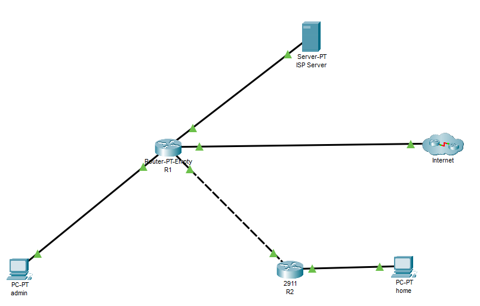
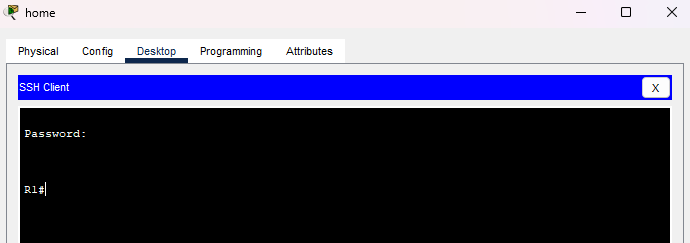
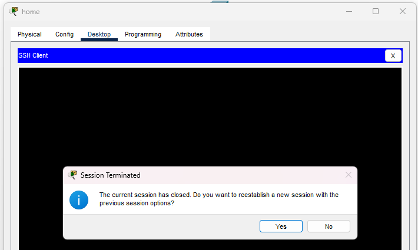

# Отчёт по лабораторной работе 1.2
**Тема:** Настройка удаленного доступа, DHCP, NAT, ACL  
**Выполнил:** Малыгин А. С., гр. 539  

## Топология
  
## Ответы на вопросы
1. **Какой вариант подключения по SSH с ПК admin к R1 не сработал и почему?**  
Подключение через SSH прошло успешно. Вариант подключения через протокол Telnet не сработал, т.к. в настройках роутера подключение через Telnet было принудительно запрещено:  
```
transport input ssh
```     
  

2. **Какие IP-адрес и маску подсети получил R2?**  
IP - 192.168.20.2; Mask - 255.255.255.0 (/24)  
**Проверьте таблицу маршрутизации на R2**  
```
show ip route

Gateway of last resort is 192.168.20.1 to network 0.0.0.0

     192.168.10.0/24 is variably subnetted, 2 subnets, 2 masks
C       192.168.10.0/24 is directly connected, GigabitEthernet0/1
L       192.168.10.1/32 is directly connected, GigabitEthernet0/1
     192.168.20.0/24 is variably subnetted, 2 subnets, 2 masks
C       192.168.20.0/24 is directly connected, GigabitEthernet0/0
L       192.168.20.2/32 is directly connected, GigabitEthernet0/0
S*   0.0.0.0/0 [254/0] via 192.168.20.1
```  
**Появился ли маршрут по умолчанию? Если да, то через какой next-hop он ведёт?**  
Маршрут по умолчанию появился и ведёт через маршрутизатор R1  
```
S*   0.0.0.0/0 [254/0] via 192.168.20.1
```  
3. **Какой IP-адрес получил ПК? Совпадают ли шлюз по умолчанию и DNS-сервер с указанными в DHCP-пуле?**  
  
IP-адрес - 192.168.10.2  
```
ip dhcp pool DHCP-POOL
 network 192.168.10.0 255.255.255.0
 default-router 192.168.10.1
 dns-server 100.0.0.2
```
Маршрут по умолчанию и DNS-сервер совпадают.  

4. **Приведите вывод команд проверки DHCP-сервера:**  
Список привязок IPv4 к MAC-адресам:
```
R2#sh ip dhcp binding 
IP address       Client-ID/              Lease expiration        Type
                 Hardware address
192.168.10.2     000A.41CC.B433           --                     Automatic
```
Информация о настроенных пулах:
```
R2#sh ip dhcp pool 

Pool DHCP-POOL :
 Utilization mark (high/low)    : 100 / 0
 Subnet size (first/next)       : 0 / 0 
 Total addresses                : 254
 Leased addresses               : 1
 Excluded addresses             : 1
 Pending event                  : none

 1 subnet is currently in the pool
 Current index        IP address range                    Leased/Excluded/Total
 192.168.10.1         192.168.10.1     - 192.168.10.254    1    / 1     / 254
```  
5.  **Проверьте с ПК home доступность IP-адреса Server0 (100.0.0.2) утилитой ping. Попробуйте объяснить результат проверки.**  
```
C:\>ping 100.0.0.2

Pinging 100.0.0.2 with 32 bytes of data:

Request timed out.
Request timed out.
Request timed out.
Request timed out.
```  
Эхо-запрос доходит до Server0 и возвращается на R1. R1 видит, что в Dst. IP указан 192.168.10.2 , смотрит в таблицу маршрутизации и видит, что сеть 192.168.10.0 подключена к нему напрямую, но у него нет MAC-адреса Dst. IP, поэтому он отправляет ARP-запрос в эту сеть. В этой сети оказывается всего один хост (admin), у которого IP-адрес - 192.168.10.100, поэтому он сбрасывает запрос. Поскольку у R1 нет никаких маршрутов для R2 с next-hop = home, пакет всегда будет отправляться на сеть admin. 
  
  6. **Повторите проверку доступности 100.0.0.2 с ПК home. Какой результат получен теперь?**  
  ```
  
C:\>ping 100.0.0.2

Pinging 100.0.0.2 with 32 bytes of data:

Reply from 100.0.0.2: bytes=32 time=57ms TTL=126
Reply from 100.0.0.2: bytes=32 time<1ms TTL=126
Reply from 100.0.0.2: bytes=32 time<1ms TTL=126
Reply from 100.0.0.2: bytes=32 time<1ms TTL=126

Ping statistics for 100.0.0.2:
    Packets: Sent = 4, Received = 4, Lost = 0 (0% loss),
Approximate round trip times in milli-seconds:
    Minimum = 0ms, Maximum = 57ms, Average = 14ms

  ```  
  
7. **Приведите вывод таблицы трансляций на R2 (show ip nat translations).**  
```
R2#sh ip nat translations
Pro  Inside global     Inside local       Outside local      Outside global
icmp 192.168.20.2:17   192.168.10.2:17    100.0.0.2:17       100.0.0.2:17
icmp 192.168.20.2:18   192.168.10.2:18    100.0.0.2:18       100.0.0.2:18
icmp 192.168.20.2:19   192.168.10.2:19    100.0.0.2:19       100.0.0.2:19
icmp 192.168.20.2:20   192.168.10.2:20    100.0.0.2:20       100.0.0.2:20
```  

8. **Проверьте доступность узла 8.8.8.8 утилитой ping с ПК home. Объясните результат. Какие диапазоны IPv4-адресов относятся к приватным (RFC 1918)? Допустимо ли их использование в глобальной сети Интернет без трансляции?**  
```
C:\>ping 8.8.8.8

Pinging 8.8.8.8 with 32 bytes of data:

Request timed out.
Request timed out.
Request timed out.
Request timed out.

Ping statistics for 8.8.8.8:
    Packets: Sent = 4, Received = 0, Lost = 4 (100% loss),
```  
Эхо-запрос доходит до google-сервера, но сбрасывается на обратном пути, т.к. в Dst. IP указан серый (приватный) IP-адрес и маршрутизатор не понимает куда посылать пакет.  
К приватным IPv4-адресам (RFC 1918) относятся:  
**10.0.0.0 – 10.255.255.255 /8  
172.16.0.0 – 172.31.255.255 /12  
192.168.0.0 – 192.168.255.255 /24**  
Такие адреса нельзя использовать в сети Интернет без трансляции, т.к. они могут быть присвоины множеству устройств в различных локальных сетях, маршрутизатор не поймёт какому именно устройству пересылать пакет.  
  
9. **Повторите проверку доступности 8.8.8.8 и 100.0.0.2 командой ping с ПК home. Какой результат получен? Приведите вывод таблицы трансляций на R1 (show ip nat translations). Почему для пакетов, идущих к 8.8.8.8, трансляция создается, а для пакетов к 100.0.0.2 — нет?**  
```
C:\>ping 8.8.8.8

Pinging 8.8.8.8 with 32 bytes of data:

Reply from 8.8.8.8: bytes=32 time<1ms TTL=125
Reply from 8.8.8.8: bytes=32 time<1ms TTL=125
Reply from 8.8.8.8: bytes=32 time<1ms TTL=125
Reply from 8.8.8.8: bytes=32 time<1ms TTL=125

Ping statistics for 8.8.8.8:
    Packets: Sent = 4, Received = 4, Lost = 0 (0% loss),
Approximate round trip times in milli-seconds:
    Minimum = 0ms, Maximum = 0ms, Average = 0ms

C:\>ping 100.0.0.2

Pinging 100.0.0.2 with 32 bytes of data:

Reply from 100.0.0.2: bytes=32 time<1ms TTL=126
Reply from 100.0.0.2: bytes=32 time<1ms TTL=126
Reply from 100.0.0.2: bytes=32 time<1ms TTL=126
Reply from 100.0.0.2: bytes=32 time<1ms TTL=126

Ping statistics for 100.0.0.2:
    Packets: Sent = 4, Received = 4, Lost = 0 (0% loss),
Approximate round trip times in milli-seconds:
    Minimum = 0ms, Maximum = 0ms, Average = 0ms
```  
Эхо-запросы прошли успешно и без потерь.  
```
R1#sh ip nat translations 
Pro  Inside global     Inside local       Outside local      Outside global
icmp 100.0.0.9:53      192.168.20.2:53    8.8.8.8:53         8.8.8.8:53
icmp 100.0.0.9:54      192.168.20.2:54    8.8.8.8:54         8.8.8.8:54
icmp 100.0.0.9:55      192.168.20.2:55    8.8.8.8:55         8.8.8.8:55
icmp 100.0.0.9:56      192.168.20.2:56    8.8.8.8:56         8.8.8.8:56
```  
Пакеты, идущие к 8.8.8.8, отправляются в Интернет, поэтому серый Src. IP-адрес 192.168.20.2 приходится менять на белый 100.0.0.9. Идущие же к 100.0.0.2 пакеты остаются в локальной сети, и транслировать их Src. IP в белый не нужно.  
  
10. **Откройте Telnet / SSH Client на ПК home и попробуйте подключиться по SSH к R1. Устанавливается ли соединение? Как такую ситуацию можно охарактеризовать с точки зрения информационной безопасности?**  
  
Соединение устанавливается успешно. С точки зрения ИБ это неправильно, потому что любое устройство, знающее логин и пароль админа, может подключиться к R1; нет разграничения прав доступа.  
  
11. **Опишите полученные результаты после создания списка доступа на R1. Что изменилось?**  
  
Теперь возможность подключения через SSH к R1 доступна только из админской сети (admin).  
  
12. **Приведите результат выполнения команды show ip access-lists TO-SERVER после настройки расширенного списка доступа на R1.**  
```
R1#sh ip access-lists TO-SERVER
Extended IP access list TO-SERVER
    permit ip 192.168.10.0 0.0.0.255 100.0.0.0 0.0.0.3
    permit udp any host 100.0.0.2 eq domain
    permit udp any eq domain host 100.0.0.2
    permit tcp any host 100.0.0.2 eq www
    permit icmp 192.168.10.0 0.0.0.255 host 100.0.0.2
```  
  
13. **Выполните проверку доступности Server0 (100.0.0.2) утилитой ping с ПК home, а затем с ПК admin. Какое правило созданного списка доступа блокирует эхо-запросы от ПК home?**  
```
host
C:\>ping 100.0.0.2

Pinging 100.0.0.2 with 32 bytes of data:

Reply from 192.168.20.1: Destination host unreachable.
Reply from 192.168.20.1: Destination host unreachable.
Reply from 192.168.20.1: Destination host unreachable.
Reply from 192.168.20.1: Destination host unreachable.

Ping statistics for 100.0.0.2:
    Packets: Sent = 4, Received = 0, Lost = 4 (100% loss),

admin
C:\>ping 100.0.0.2

Pinging 100.0.0.2 with 32 bytes of data:

Reply from 100.0.0.2: bytes=32 time<1ms TTL=127
Reply from 100.0.0.2: bytes=32 time<1ms TTL=127
Reply from 100.0.0.2: bytes=32 time<1ms TTL=127
Reply from 100.0.0.2: bytes=32 time<1ms TTL=127

Ping statistics for 100.0.0.2:
    Packets: Sent = 4, Received = 4, Lost = 0 (0% loss),
Approximate round trip times in milli-seconds:
    Minimum = 0ms, Maximum = 0ms, Average = 0ms
```  
Эхо-запросы от ПК home блокирует скрытое правило  ``deny ip any any``. Когда эхо-запрос приходит на R2, он транслируется в Src. IP 192.168.20.2. Новый Src. IP не подходит ни под одно правило, и пакет сбрасывается скрытым правилом. Последний шаг обработки пакета в режиме симуляции (**<u>dropped by default</u>**): ``4. The packet does not match the criteria of any statement in the access-list. The packet is denied and dropped by default.``
  
14. **Откройте Web Browser на обоих ПК и перейдите на страницы portal.isp.net и google.com. Снова выведите статистику списка доступа командой show ip access-lists TO-SERVER. Изучите счетчики совпадений (matches). Какое из созданных правил является избыточным (бесполезным) и почему?**  
```
R1#show ip access-lists TO-SERVER
Extended IP access list TO-SERVER
    permit ip 192.168.10.0 0.0.0.255 100.0.0.0 0.0.0.3
    permit udp any host 100.0.0.2 eq domain (19 match(es))
    permit udp any eq domain host 100.0.0.2 (5 match(es))
    permit tcp any host 100.0.0.2 eq www (128 match(es))
    permit icmp 192.168.10.0 0.0.0.255 host 100.0.0.2
```  
Правило ``permit icmp 192.168.10.0 0.0.0.255 host 100.0.0.2`` является бесполезным из-за правила `` permit ip 192.168.10.0 0.0.0.255 100.0.0.0 0.0.0.3``, которое разрешает абсолютно любой IP-трафик из сети 192.168.10.0 на устройства 100.0.0.0 - 100.0.0.3, в которые входит DNS-сервер 100.0.0.2. Выборка правила идёт сверху вниз и останавливается при первом совпадении, поэтому для IP-пакетов из сети 192.168.10.0 всегда будет применятся лишь первое правило.  
  
15. **Проверьте состояние синхронизации командой show ntp status. Почему маршрутизатор R1 успешно синхронизирует время с сервером, несмотря на то, что в исходящем списке доступа TO-SERVER на интерфейсе Gi1/0 отсутствует разрешающее правило для протокола NTP?**  
Маршрутизатор успешно синхронизирует время с сервером, потому что исходящий пакет создан самим маршрутизатором, а списки доступа никогда не проверяют локально сгенерированные пакеты.  
``4. The outgoing port has an outbound traffic access-list with an ID of TO-SERVER, but the packet is locally generated. The device permits the packet without checking against the access-list.``